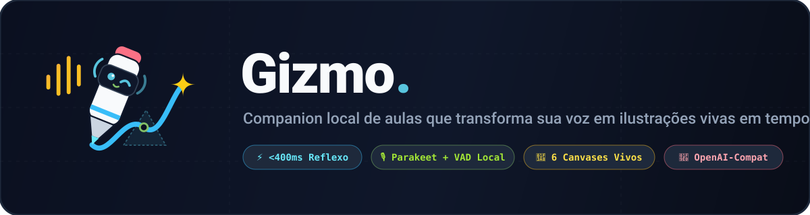
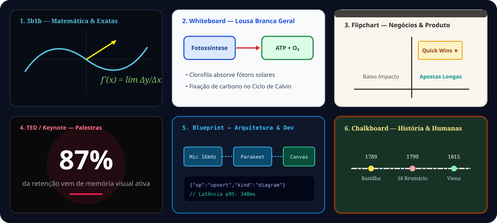
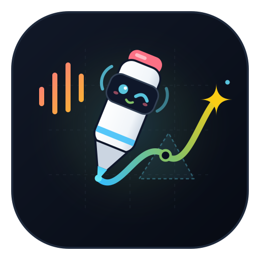

<p align="center">
  
</p>

<p align="center">
  <strong>Enquanto você explica, o Gizmo escuta localmente e desenha gráficos, equações, diagramas e animações vivas em sub-segundo.</strong>
</p>

<p align="center">
  
  
  
  
</p>

---

## Como rodar

```bash
pnpm install
pnpm tauri dev        # app nativo completo (microfone + cérebro LLM)
```

Prévia rápida da interface sem microfone:

```bash
pnpm dev              # abre o Studio no navegador
```

No Studio, use **[Aula Demo]** para ver os seis estilos, os 14 tipos de nó e a linha do tempo de beats sem configurar nada. Os testes e o build nativo:

```bash
pnpm typecheck
pnpm test
cargo test --manifest-path src-tauri/Cargo.toml
sudo apt-get install -y file      # dependência do bundler AppImage no Linux
APPIMAGE_EXTRACT_AND_RUN=1 pnpm tauri build --debug
```

## Builds multiplataforma (GitHub Actions)

O workflow [`.github/workflows/build.yml`](./.github/workflows/build.yml) compila o aplicativo em paralelo para **Windows, macOS e Linux**:

- **Windows:** instalador `.exe` (NSIS) e `.msi`
- **macOS:** `.dmg`
- **Linux:** `.deb`, `.rpm` e `.AppImage`

Para gerar os artefatos: abra **Actions → Build Gizmo → Run workflow**. Os arquivos ficam disponíveis em **Artifacts** na execução (`gizmo-Windows`, `gizmo-macOS`, `gizmo-Linux`).

Para criar uma release com download público, publique uma tag:

```bash
git tag v0.1.0
git push origin v0.1.0
```

A release é criada automaticamente com todos os binários anexados.

## O que é o Gizmo?

**Gizmo** (*"Giz"* + *"Gizmo"*) é um aplicativo desktop local, multiplataforma (Windows, macOS e Linux) e de **baixíssima latência**, projetado para atuar como um **copiloto visual ao vivo** para professores, palestrantes, mentores e criadores de conteúdo educacional.
Você simplesmente abre o Gizmo, escolhe seu microfone (ou deixa no automático) e começa a dar sua aula normalmente:

1. **Ouvidos Locais Ultrarrápidos (`sherpa-onnx` em Rust):** Captura áudio em frames lock-free de `32ms`, detecta voz com **Silero VAD v5** (micro-pausa de `280ms`) e transcreve localmente em 25+ idiomas com **NVIDIA Parakeet TDT 0.6B v3 INT8** (ou **Whisper Turbo INT8** para 99 idiomas / **SenseVoice Small INT8**), rodando janelas especulativas a cada `400ms` com *Real-Time Factor* de `~0.015` em CPU comum.
2. **Reflexo Local Instantâneo (`Tier-0 < 10ms`):** Antes mesmo de consultar o LLM, um motor léxico local em Rust/TS destaca nós já presentes na tela quando você aponta verbalmente (*"repare no termo ao quadrado"*, *"olhem para o segundo passo"*) e reage à energia da sua voz a 60fps.
3. **Cérebro Universal (`OpenAI-Compatible API`):** Conecta-se a qualquer servidor local (`Ollama`, `LM Studio`, `llama.cpp`, `vLLM`, `MLX`) ou em nuvem (`Groq`, `OpenRouter`, `OpenAI`, `Cerebras`, `DeepSeek`, `Gemini OpenAI-compat`). Usa prompts alinhados para **95% de acerto em KV-Cache**, desativa `<think>` oculto e transmite **operações atômicas linha-a-linha em NDJSON** via SSE.
4. **Canvas Auto-Estilizado de 60/120fps:** Cada linha NDJSON atualiza incrementalmente um **SceneGraph semântico** (sem regerar a cena inteira e sem adivinhar pixels!), adaptando automaticamente fundo, tipografia, traço, filtros SVG e curvas de animação ao estilo da aula.

---

## Os 6 Estilos Automáticos de Canvas

<p align="center">
  
</p>

| ID do Tema | Tipo de Aula Detectado | Estética Visual & Renderizador |
| :--- | :--- | :--- |
| **`3b1b`** | Matemática, Física, Cálculo, Estatística | Fundo escuro `#070B14`, tipografia *Computer Modern / KaTeX*, ciano `#58C4DD`, amarelo `#FFFF00` e verde `#83C167`, animação vetorial `stroke-dashoffset`, eixos cartesianos e vetores. |
| **`whiteboard`** | Aulas Gerais, Biologia, Química, Idiomas, Tutoria | Lousa branca `#F8FAFC` com grade pontilhada sutil, pincéis azul/vermelho/verde/carvão, cartões didáticos, sublinhados circulares e post-its. |
| **`flipchart`** | Negócios, Produto, Marketing, Estratégia, Vendas | Bloco de papel creme `#FAF6EE` com barra superior de grampo, traços orgânicos **Rough.js** (com *seed* determinístico sem *jitter*), marcador Sharpie + marca-texto âmbar, matrizes 2x2, funis e KPIs. |
| **`ted`** | Palestras, Keynotes, Storytelling, Pitch | Palco escuro cinematográfico `#09090B` com *spotlight* radial sutil, tipografia editorial gigante, máximo impacto minimalista (1 grande número, frase ou metáfora visual por vez). |
| **`blueprint`** | Engenharia de Software, Arquitetura, DevOps, IA | Fundo azul-ardósia técnico `#0F172A` com malha milimetrada, fonte monoespaçada *JetBrains Mono*, blocos de arquitetura, fluxo de pacotes animados e blocos de código com *highlight* de linhas. |
| **`chalkboard`** | História, Filosofia, Literatura, Direito, Humanas | Quadro verde-escuro clássico `#173326` com moldura amadeirada sutil, filtro SVG `feTurbulence` de textura de giz seco, linhas do tempo históricas e mapas conceituais. |

---

## Orçamento Rigoroso de Latência (End-to-End SLA)

| Etapa do Pipeline | Meta p50 | Meta p95 | Técnica Arquitetural Chave |
| :--- | :---: | :---: | :--- |
| **Áudio -> Detecção de Fala (VAD)** | `18 ms` | `35 ms` | `cpal` -> ring buffer lock-free `rtrb` -> `rubato` 16kHz -> Silero VAD (janela 512 amostras / `32ms`). |
| **Reflexo Visual Local (Tier-0)** | `6 ms` | `12 ms` | Matcher léxico local sobre rótulos/símbolos já visíveis + comando de voz instantâneo sem esperar rede/LLM. |
| **Transcrição Parcial / Final (ASR)** | `42 ms` | `85 ms` | Parakeet TDT 0.6B v3 INT8 (`RTF ~0.015`) com tick especulativo de `400ms` e micro-pausa VAD de `280ms`. |
| **LLM Time-to-First-Op (Local GPU / API Rápida)** | `180 ms` | `420 ms` | Prefixo 100% estático (KV-Cache hit), `enable_thinking: false`, protocolo **NDJSON** (1ª linha tem ~28 tokens). |
| **Layout + Pintura de Frame no Canvas** | `2.4 ms` | `6.0 ms` | Solver determinístico de Zonas + Dagre incremental + 3 camadas GPU (`transform`/`opacity` apenas). |
| **Total Percebido (Fala -> 1ª Reação Visual)** | **`< 350 ms`** | **`< 650 ms`** | Combinação de pulso reativo de voz + Reflexo Tier-0 + 1ª linha NDJSON chegando via stream SSE. |

---

## Mapa Completo da Especificação

Este repositório contém a **especificação de engenharia completa, exaustiva e sem ambiguidades** para construção integral do aplicativo.

> **Vai colocar um Agente de IA para programar este projeto?**  
> Aponte o agente diretamente para **[`AGENTS.md`](./AGENTS.md)** — ele contém as regras inegociáveis, armadilhas proibidas e a ordem exata de leitura e implementação.

### Documentos de Especificação (`specs/`)

1. **[`specs/00-INDEX-AND-GLOSSARY.md`](./specs/00-INDEX-AND-GLOSSARY.md)** — Índice mestre, glossário ubíquo, metas de latência (SLAs) e Registros de Decisão Arquitetural (ADRs 001–010).
2. **[`specs/01-LOW-LATENCY-ARCHITECTURE.md`](./specs/01-LOW-LATENCY-ARCHITECTURE.md)** — Arquitetura fim-a-fim de sub-segundo, topologia de threads no Rust, canais `crossbeam`/`tokio`, IPC Tauri v2, controle de *backpressure* e *cancel-safe coalescing*.
3. **[`specs/02-AUDIO-VAD-ASR-PIPELINE.md`](./specs/02-AUDIO-VAD-ASR-PIPELINE.md)** — Captura `cpal` multiplataforma, reamostragem `rubato`, máquina de estados Silero VAD v5, integração exata com `sherpa-onnx` (Parakeet TDT 0.6B v3 INT8, Whisper Turbo INT8, SenseVoice Small INT8) e gerenciador local de download/extração `.tar.bz2`.
4. **[`specs/03-BRAIN-LLM-STREAMING-ENGINE.md`](./specs/03-BRAIN-LLM-STREAMING-ENGINE.md)** — Cliente OpenAI-compatível universal em Rust (`reqwest` SSE), estrutura de mensagens pró-KV-Cache, supressão de *reasoning* lento, Motor de Reflexo Local Tier-0 (`<10ms`), agendador semântico e **Prompts de Sistema Exatos**.
5. **[`specs/04-SCENE-GRAPH-AND-NDJSON-DSL.md`](./specs/04-SCENE-GRAPH-AND-NDJSON-DSL.md)** — Especificação formal do protocolo de streaming **NDJSON** (10 operações atômicas) e dos **14 tipos de nós visuais** (`math`, `plot_2d`, `chart`, `diagram`, `bullets`, `code`, `matrix_2x2`, `funnel`, `timeline`, `geometry_2d`, `callout`, `kpi`, `comparison`, `freehand_note`), incluindo parser tolerante a falhas.
6. **[`specs/05-THEMES-AND-STYLE-ENGINE.md`](./specs/05-THEMES-AND-STYLE-ENGINE.md)** — Tokens CSS completos, tipografias locais empacotadas, filtros SVG (giz, brilho neon, papel), configuração determinística do Rough.js, curvas de animação e heurística híbrida de detecção automática do estilo da aula.
7. **[`specs/06-LAYOUT-AND-RENDERING-ENGINE.md`](./specs/06-LAYOUT-AND-RENDERING-ENGINE.md)** — Algoritmo determinístico de *Semantic Zones* + sub-layout Dagre (`<1.5ms`, zero sobreposição), arquitetura de 3 camadas 60/120fps, plotador matemático seguro (`expr-eval` sem `eval()`), KaTeX pré-aquecido e *morphing* suave de equações e nós.
8. **[`specs/07-UI-UX-AND-PRESENTER-MODE.md`](./specs/07-UI-UX-AND-PRESENTER-MODE.md)** — Wireframes detalhados da Janela Studio (professor) e Janela Projetor/OBS (frameless, fundo transparente/chroma opcional, 2º monitor), atalhos globais de teclado, linha do tempo da aula (replay/exportação SVG/PNG/Markdown) e estados animados do mascote Gizmo.
9. **[`specs/08-EXACT-SCAFFOLD-AND-CONTRACTS.md`](./specs/08-EXACT-SCAFFOLD-AND-CONTRACTS.md)** — Árvore completa de diretórios e código-fonte base exato: `package.json`, `Cargo.toml`, `tauri.conf.json`, `tsconfig.json`, tipos compartilhados Rust/TypeScript, stores Zustand e o componente `<GizmoMascot />`.
10. **[`specs/09-STEP-BY-STEP-BUILD-PLAN.md`](./specs/09-STEP-BY-STEP-BUILD-PLAN.md)** — Roteiro sequencial em **10 Fases Atômicas** para construção do zero até o binário final, com checklists de verificação, testes unitários/integração e guia de resolução de erros comuns.

### Schemas Formais (`schemas/`) & Identidade Visual (`assets/`)

- [`schemas/ndjson-ops.schema.json`](./schemas/ndjson-ops.schema.json) — JSON Schema Draft 2020-12 das operações de streaming NDJSON.
- [`schemas/scene-graph.schema.json`](./schemas/scene-graph.schema.json) — JSON Schema Draft 2020-12 do grafo de cena canônico.
- [`schemas/app-config.schema.json`](./schemas/app-config.schema.json) — JSON Schema Draft 2020-12 das configurações persistidas localmente.
- [`assets/logo.svg`](./assets/logo.svg) | [`assets/logo-banner.svg`](./assets/logo-banner.svg) | [`assets/logo-icon.svg`](./assets/logo-icon.svg) | [`assets/logo-monochrome.svg`](./assets/logo-monochrome.svg) | [`assets/themes-preview.svg`](./assets/themes-preview.svg)

---

## Identidade Visual: Conheça o Gizmo

<p align="center">
  
  &nbsp;&nbsp;&nbsp;&nbsp;
  
</p>

O mascote **Gizmo** une os três pilares do produto em formas geométricas puras e fáceis de animar em SVG:
- **Ondas Sonoras à Esquerda + Arcos Acústicos:** Representam os ouvidos locais atentos (Silero VAD + Parakeet multilíngue).
- **Corpo de Giz/Stylus Inclinado a `22°` com Visor Expressivo:** Personalidade amigável de companheiro de sala de aula.
- **Ponta Luminescente Desenhando Curva + Triângulo + Faísca:** Representa a transformação imediata da fala em geometria, gráficos e ideias vivas.
