# 01 — Arquitetura de Baixíssima Latência (Sub-Segundo Fim-a-Fim)

## 1. Filosofia Central: Por Que Apps Comuns Atrasam 8 Segundos e o Gizmo Reage em `< 400ms`

Um pipeline ingênuo faz:
`Esperar 1.5s de silêncio -> Rodar ASR lento (800ms) -> Enviar cena gigante pro LLM -> Esperar LLM terminar 1500 tokens (15s!) -> Parsear JSON -> Re-renderizar DOM inteiro`.
Resultado: **10 a 20 segundos de atraso** — completamente inútil numa aula ao vivo.

O **Gizmo** elimina cada um desses gargalos com **5 pilares arquiteturais simultâneos**:

1. **Áudio Lock-Free + Micro-Janela Deslizante (`32ms` VAD + `400ms` Partial Tick + `280ms` Silence Commit):** Não esperamos o professor terminar um parágrafo. Enquanto ele fala, fatias curtas são transcritas em `~45ms` pelo Parakeet TDT 0.6B INT8.
2. **Reflexo Local Tier-0 (`< 10ms` sem LLM):** Energia da voz move o mascote/cursor a 60fps e menções a termos/símbolos já desenhados iluminam o nó correspondente instantaneamente antes mesmo da requisição HTTP sair.
3. **Conexão HTTP Quente (`TCP_NODELAY` + Pool Keep-Alive) + Prefixo KV-Cache Imutável:** Elimina ~120ms de handshake TLS por turno e garante ~95% de reaproveitamento de KV-Cache em `Ollama` / `llama.cpp` / `vLLM`.
4. **Protocolo NDJSON Streaming Linha-a-Linha:** Cada linha de `~30 tokens` é uma operação visual completa (`SceneOp`). No instante em que o byte `\n` chega do stream SSE em Rust, a operação vai para o Canvas e já anima na tela enquanto o LLM ainda gera a 2ª e a 3ª linhas.
5. **Solver Semântico `< 1.5ms` + Camadas GPU:** O LLM nunca calcula coordenadas em pixels; o frontend posiciona zonas sem colisão e anima exclusivamente `transform`, `opacity` e `stroke-dashoffset`.

---

## 2. Diagrama Completo do Fluxo de Dados e Threads

```mermaid
flowchart LR
  subgraph OS["Hardware & Áudio Nativo"]
    MIC["Microfone (44.1/48kHz)"]
  end

  subgraph RUST["Backend Nativo Tauri v2 (Rust)"]
    CPAL["Thread 1: cpal Callback\n(RT Priority, Zero-Alloc)"]
    RTRB[("rtrb Lock-Free\nSPSC RingBuffer")]
    VAD["Thread 2: Resampler + Silero VAD\n(rubato -> 16kHz 512-sample frames)"]
    ASR["Thread 3: sherpa-onnx Worker\n(Parakeet TDT 0.6B INT8)"]

    subgraph TOKIO["Runtime Async Tokio"]
      REFLEX["Tier-0 Local Reflex\n(< 10ms Lexical/Voice Cmd)"]
      SCHED["Coalescing Scheduler\n(Single-Flight + Delta Buffer)"]
      LLM["OpenAI-Compat SSE Client\n(reqwest + TCP_NODELAY)"]
      NDJSON["Incremental NDJSON Parser\n(Line-by-Line Validator/Repair)"]
      STATE[("Canonical SceneGraph\n+ SQLite Timeline")]
    end
  end

  subgraph WEBVIEW["Frontend WebView (Studio + Projector Windows)"]
    ZUSTAND["Zustand Store\n(Granular Selectors)"]
    LAYOUT["Deterministic LayoutEngine\n(Semantic Zones + Dagre <1.5ms)"]
    L0["Layer 0: Theme Background & Grid"]
    L1["Layer 1: SVG/KaTeX/Rough Nodes (60fps)"]
    L2["Layer 2: rAF Voice Aura & Spotlight"]
  end

  MIC --> CPAL --> RTRB --> VAD
  VAD -- "audio:level (30Hz)" --> L2
  VAD -- "Partial Tick (400ms)\nou Commit (280ms)" --> ASR
  ASR -- "AsrEvent" --> REFLEX
  REFLEX -- "Immediate Highlight/Cmd" --> STATE
  REFLEX -- "Transcript Delta" --> SCHED
  SCHED -- "HTTP POST stream=true" --> LLM
  LLM -- "SSE chunks" --> NDJSON
  NDJSON -- "Validated SceneOp" --> STATE
  STATE -- "Tauri Event: scene:op" --> ZUSTAND
  ZUSTAND --> LAYOUT --> L1
  ZUSTAND --> L0
```



---

## 3. Topologia Exata de Threads no Processo Rust (`src-tauri`)

> **REGRA CRÍTICA PARA O AGENTE CONSTRUTOR:**  
> **NUNCA** chame `recognizer.decode()` do `sherpa-onnx` diretamente dentro de uma `async fn` do Tokio sem isolá-la! Inferência ONNX usa 100% de múltiplos núcleos de CPU por 35–85ms; se rodar num worker thread do Tokio, ela **congela** o recebimento de chunks SSE do LLM e atrasa a emissão de eventos IPC para a UI!

Você **DEVE** instanciar exatamente estes 4 contextos de execução independentes:

### 3.1. `Thread 1 — cpal-audio-in` (Gerenciada pelo `cpal`)
- **Responsabilidade única:** Ler o slice de áudio entregue pelo SO, converter cada sample para `f32` mono normalizado `[-1.0, 1.0]` e chamar `producer.push(sample)` no `rtrb::Producer<f32>`.
- **Se o buffer estiver cheio (`PushError::Full`):** Descarte silenciosamente as amostras excedentes e incremente um contador `AtomicU64` (`dropped_samples`). **Jamais** bloqueie ou faça log dentro do callback.
- **Capacidade do `rtrb::RingBuffer<f32>`:** `96_000` floats (`2 segundos` a `48kHz`). Consome apenas `384 KB` de RAM e absorve qualquer escalonamento do SO.

### 3.2. `Thread 2 — gizmo-vad-loop` (`std::thread::Builder::new().name("gizmo-vad".into())`)
- **Responsabilidade:**
  1. Drenar blocos do `rtrb::Consumer<f32>` a cada `10ms` (`thread::sleep(Duration::from_millis(10))` quando insuficiente).
  2. Passar pelo `rubato::FastFixedIn<f32>` se `input_sample_rate != 16_000` para produzir amostras exatas a `16_000 Hz`.
  3. Acumular blocos exatos de `512` amostras (`32ms` = 1 `AudioFrame`).
  4. Calcular o RMS suavizado (`ema_rms = 0.7 * prev_rms + 0.3 * frame_rms`) e emitir no máximo a cada `33ms` (`~30Hz`) o evento leve `audio:level` (`{ rms: f32, is_speaking: bool }`).
  5. Alimentar o `VoiceActivityDetector` (Silero VAD) e gerenciar o buffer da fala atual (`active_utterance_pcm: Vec<f32>`).
  6. Enviar tarefas `AsrJob` por um canal `crossbeam_channel::bounded::<AsrJob>(2)` (ou `tokio::sync::mpsc::channel(2)` usando `try_send`) para a `Thread 3`.
- **Detalhe genial de *Backpressure* no canal VAD -> ASR:**
  - Para `AsrJob::Partial`: use `try_send`. Se a `Thread 3` ainda estiver ocupada decodificando o parcial anterior (ex.: numa CPU muito antiga), o parcial intermediário é **descartado imediatamente** sem acumular fila!
  - Para `AsrJob::Final`: use envio garantido (ou um slot separado de prioridade `final_slot: Arc<Mutex<Option<AsrJob>>>` + `Condvar`) para que **nenhuma frase finalizada seja perdida**!

### 3.3. `Thread 3 — gizmo-asr-worker` (`std::thread::Builder::new().name("gizmo-asr".into())`)
- **Responsabilidade:** Deter com exclusividade (`!Sync` / single-owner sem contenção de Mutex!) a instância carregada de `sherpa_onnx::OfflineRecognizer`.
- **Configuração de Threads ONNX (`num_threads`):**
  ```rust
  let logical_cores = std::thread::available_parallelism().map(|n| n.get()).unwrap_or(4);
  let onnx_threads = (logical_cores / 2).clamp(2, 4) as i32;
  ```
  *(Usar entre 2 e 4 threads entrega a menor latência em modelos de 0.6B sem saturar os núcleos necessários para o WebView e o SO! Acima de 4 threads em janelas curtas de 4s o overhead de sincronização OpenMP/ONNX piora a latência).*
- Ao concluir `decode()`, envia `AsrTranscriptEvent` para o runtime Tokio via `tokio::sync::mpsc::UnboundedSender<AsrTranscriptEvent>`.

### 3.4. `Contexto 4 — Tokio Async Orchestrator`
- Gerencia:
  1. **`ReflexEngine`**: Inspeção síncrona em `< 1ms` sobre `AsrTranscriptEvent`, emitindo `SceneOp` imediato se houver match de comando ou destaque léxico.
  2. **`CoalescingScheduler`**: Decide quando disparar um turno ao LLM, aglutinando parciais/finais enquanto uma requisição já está em voo.
  3. **`LlmSseClient`**: Mantém `reqwest::Client` único (singleton no `AppState`) com `tcp_nodelay(true)`, `pool_max_idle_per_host(4)` e `pool_idle_timeout(Duration::from_secs(90))`.
  4. **`NdjsonStreamProcessor`**: Lê bytes do SSE, extrai linhas `\n`, repara pequenos desvios JSON, aplica ao `CanonicalSceneGraph` em Rust e emite `app_handle.emit("scene:op", &op)` na mesma hora!
  5. **`SqliteSessionRecorder`**: Persiste transcrições e `SceneOp`s assincronamente num canal em background sem nunca bloquear o caminho crítico da renderização.

---

## 4. Máquina de Estados do Agendador Coalescente (*Single-Flight Coalescing Scheduler*)

Este componente impede os dois piores bugs de apps em tempo real: **filas atrasadas** (mostrar o gráfico do minuto 1 quando o professor já está no minuto 2) e **condições de corrida** (duas respostas do LLM sobrescrevendo o mesmo nó fora de ordem).

### Estados do Scheduler
- **`Idle`**: Nenhuma chamada LLM ativa.
- **`InFlight { turn_id, started_at, cancel_token, ops_emitted_count }`**: Uma stream SSE está aberta e aplicando linhas NDJSON em tempo real.

### Regras Exatas de Disparo e Coalescência

1. **Buffer Acumulador (`pending_text: String`):**
   - Toda frase final (`is_final == true`) é anexada a `pending_text`.
   - Para parciais (`is_final == false`), mantemos `uncommitted_partial: String` contendo apenas o sufixo **ainda não enviado** da fala atual (`utterance_id`).
2. **Condição de Disparo quando `state == Idle`:**
   Dispare imediatamente `spawn_llm_turn()` se **QUALQUER** uma destas condições for verdadeira:
   - **Gatilho A (Fim de Cláusula):** Chegou um `AsrTranscriptEvent` com `is_final == true` e `(pending_text.split_whitespace().count() >= 3)` (exceto muletas puras como *"é... então... tipo assim"*).
   - **Gatilho B (Fala Contínua Longa sem Pausa):** `is_final == false`, já se passaram `>= 950ms` desde o último turno concluído, e o sufixo estável novo tem `>= 9 palavras` contendo substantivos/números/verbos de ação. Ao disparar num parcial, marque `committed_char_offset` daquele `utterance_id` para não reenviar as mesmas palavras quando o `is_final` chegar!
   - **Gatilho C (Ação Manual do Usuário na UI):** O usuário digitou um prompt rápido ou clicou em *"Ilustrar Agora"*.
3. **O que acontece se chegar mais fala enquanto `state == InFlight`?**
   - **NÃO** dispare uma segunda requisição paralela! Apenas acumule o texto novo em `pending_text`.
   - **Regra de Preempção por *Barge-In* / Mudança Brusca:**
     - Se o professor usar marcador explícito de correção (*"não, espera"*, *"esquece isso"*, *"mudando de assunto"*, *"actually wait"*) **OU** `pending_text` acumular `> 35 palavras` enquanto um LLM lento está travado há `> 2500ms` com `ops_emitted_count == 0`:
       - Acione `cancel_token.cancel()` na requisição atual!
       - Como todas as linhas NDJSON anteriores a `cancel()` já eram atômicas e válidas (ou zero linhas foram emitidas), o `SceneGraph` permanece **100% consistente**!
       - Dispare imediatamente um novo turno com todo o `pending_text` atualizado.
   - **Fluxo Normal Rápido:** Assim que a stream `InFlight` recebe `[DONE]` (normalmente em `400ms–1200ms`), o loop verifica se `pending_text` acumulou `>= 4 palavras` durante o voo; se sim, dispara imediatamente o próximo turno (`0ms` de cooldown artificial!).

---

## 5. Contratos de Eventos IPC Tauri v2 (Baixo Overhead)

Todos os eventos do Rust para o Frontend usam `app.emit(event_name, payload)` (broadcast para `StudioWindow` e `ProjectorWindow` simultaneamente):

| Nome do Evento | Frequência Máxima | Payload Resumido | Consumidor na UI |
| :--- | :---: | :--- | :--- |
| `audio:level` | `30 Hz` (`33ms`) | `{ rms: f32, peak: f32, speaking: bool }` | `Layer 2` (rAF ref direto, **sem re-render React!**) |
| `asr:partial` | `2.5 Hz` (`400ms`) | `{ utteranceId: string, text: string, language: string }` | Barra de legenda ao vivo na `StudioWindow` |
| `asr:final` | Por cláusula | `{ utteranceId: string, text: string, durationMs: u32, latencyMs: u32 }` | Histórico de transcrição + métricas de latência |
| `scene:op` | Por linha `\n` SSE | `SceneOp` (ver `specs/04`) | `useSceneStore` -> `LayoutEngine` -> Canvas (`Studio` + `Projector`) |
| `scene:snapshot` | Sob demanda / Replay | `SceneGraph` completo | Hidratação inicial ao abrir `ProjectorWindow` ou mover timeline |
| `brain:status` | Mudança de estado | `{ state: 'idle'\|'streaming'\|'error', ttftMs?: u32, model: string, error?: string }` | Indicador discreto de status + expressão do mascote Gizmo |
| `models:progress` | `10 Hz` no download | `{ modelId: string, downloadedBytes: u64, totalBytes: u64, phase: 'downloading'\|'extracting'\|'ready'\|'error' }` | Tela de Onboarding / Gerenciador de Modelos |

> **ATENÇÃO AGENTE CONSTRUTOR (Detalhe Crítico de Performance no `audio:level`):**  
> Nunca coloque `rms` dentro do estado principal de componentes React que envolvem o Canvas inteiro, senão o React tentará reconciliar a árvore inteira 30 vezes por segundo!  
> Em vez disso, o listener de `audio:level` deve gravar o float num objeto mutável `audioLevelRef.current = payload` consumido apenas pelo loop `requestAnimationFrame` do `<GizmoMascot />` e da `Layer 2`!

---

## 6. Telemetria Interna de Latência (HUD de Diagnóstico em Tempo Real)

Todo turno deve registrar timestamps monotônicos (`std::time::Instant`) e enviar junto nos metadados de `brain:status` / `asr:final`:
- `vad_commit_to_asr_done_ms`: Tempo gasto pelo Parakeet/Whisper.
- `asr_done_to_llm_request_ms`: Overhead do Reflexo + Scheduler (meta `< 5ms`).
- `llm_ttft_ms`: Tempo do `POST` até o primeiro chunk SSE com conteúdo.
- `llm_first_op_ms`: Tempo do `POST` até a primeira linha `\n` NDJSON validada.
- `frontend_layout_ms`: Medido com `performance.now()` no `LayoutEngine`.

Esses 5 números aparecem num **pill discreto de telemetria** no rodapé da `StudioWindow` (ex.: `🎙️ 44ms · 🧠 190ms · 🎨 1.2ms`) para que o usuário veja imediatamente a velocidade do sistema ou diagnostique se o servidor LLM escolhido está lento.
